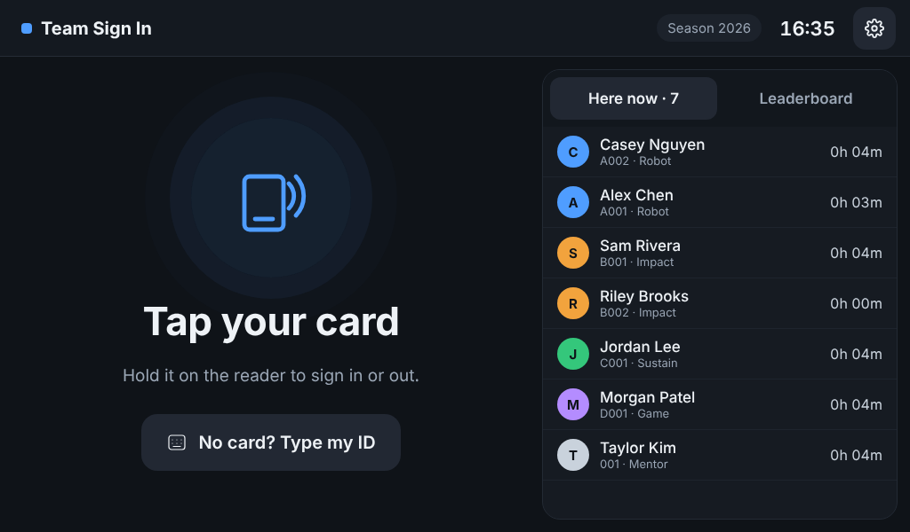
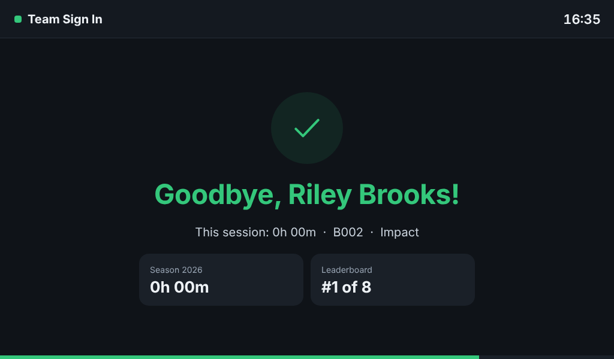
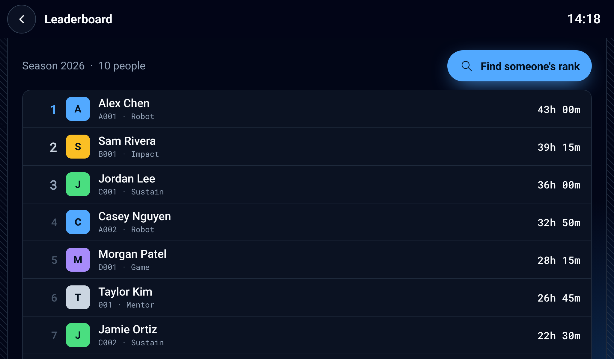

# RPi NFC Tablet

A sign-in / sign-out kiosk for a Raspberry Pi 4 B that works like a tablet. Tap
an NFC card on the reader to sign in, tap again to sign out. No card? Type your
ID on the screen. Hours are kept in MariaDB, and a "who's here" list and a
leaderboard sit beside the start screen. Everything is done by touch: there is
no keypad and no buzzer.







How each part works is explained in comments in the code itself, starting from
`nfc_login/__init__.py`.

## Hardware and wiring

- Raspberry Pi 4 B
- 7 inch 1024x600 IPS HDMI touchscreen (5-point capacitive, USB touch, built-in speakers)
- Elechouse PN532 V3 in SPI mode
- NTAG215 cards (NTAG213/216 and MIFARE Classic 1K work too)

| Part | Connections |
|---|---|
| Screen picture | Pi micro-HDMI port 0 (the one by the USB-C power) to the screen's HDMI IN |
| Screen touch and power | Pi USB port to the screen's "5V IN+TOUCH" micro USB |
| PN532 (DIP switches: 1 OFF, 2 ON) | VCC 17 (3.3 V), GND 6, SCK 23, MISO 21, MOSI 19, SS 29 |

PN532 pin numbers are the Pi's physical pin numbers. Sounds (sign in, sign out,
errors) come out of the screen's speakers over HDMI. If they're silent, pick the
HDMI output from the speaker icon on the Pi's desktop, and turn them off with
`sounds = false` in `config.toml` if you'd rather have quiet. The sounds are short
wooden knocks in `nfc_login/ui/sounds/`, made by `scripts/make_sounds.py`.

If the picture doesn't fill the screen, add `video=HDMI-A-1:1024x600@60` to the
end of the line in `/boot/firmware/cmdline.txt` and reboot.

A card tapped while someone is in admin or on the leaderboard screen still signs
in or out: a small pop-up says so and the screen stays where it was.

### The clock

The Pi has no clock battery, so after being off it starts at the time it was
shut down and gets the real time once it's online. The kiosk keeps working
offline either way. When the clock jumps (getting the real time, daylight
saving, a new time zone), every session recorded since the kiosk started moves
by the same amount, so nobody gains or loses hours. A slow or hot Pi doesn't
change the time either: it comes from a hardware timer, not from counting CPU work.

## Install on the Pi

On Raspberry Pi OS (64-bit, desktop):

```bash
git clone https://github.com/LunarcatOwO/rpi-nfc-tablet.git ~/rpi-nfc-tablet && bash ~/rpi-nfc-tablet/scripts/setup-pi.sh
```

The script asks for your sudo password and an admin PIN, then reboots. After
that the kiosk opens fullscreen by itself.

To update, open admin, then **System → Install update** when **⬇ Update** shows by
the clock. You can also update by hand: `cd ~/rpi-nfc-tablet && git pull`, then
restart the app.

## Using it

- **Sign in or out:** hold your card on the reader.
- **No card:** tap **No card? Type my ID**, tap your team, then type your number
  (mentors and captains type just the number). Check it's you, then tap **Sign in**.
- **Back:** the arrow at the top left, or swipe in from the left edge of the screen.
- **Here now / Leaderboard:** tap the tabs, or swipe the list sideways.
- **Leaderboard screen:** tap **Leaderboard** on the start screen for everyone's
  rank, then **Find someone's rank** to search by name.
- **Admin:** the gear at the top right, then the admin PIN.

Admin has three parts. **People**: add, enroll cards, remove cards, change team,
rename, deactivate, list deactivated, and find someone by name (their page has
everything you can change about them, including people brought over from the
old system who have no team yet, and **Delete**, which erases someone with
their cards and hours in every season; deactivate keeps the hours). Every "user ID" screen also has **Search by
name**. **Hours**: add/subtract, sign someone in or out, who's here, sign
everyone out, new season, past seasons, and scheduled sign-out (times each day
when everyone still signed in is signed out, each either counting their hours up
to then or not), and sign-in blocks (times on chosen days when nobody can sign
in, e.g. during class; signing out still works, and admins can still sign
people in). **System**: info,
updates, Wi-Fi, admin PIN, restart/close/minimize the app, restart/shut down the
Pi. The side list jumps between them. Only admins can enroll cards, and anything
that can't be undone asks "are you sure?" first.

### Admin PIN

The first PIN is set during setup with no questions asked. After that, changing
it (System → Change the admin PIN, or `.venv/bin/python -m nfc_login.admin set-admin-pin`)
asks for the current PIN first. On the command line, 3 wrong tries lock changing
it for 15 minutes. Forgot it? On the Pi run
`sudo .venv/bin/python -m nfc_login.admin set-admin-pin --forgot` and type `RESET`.

Anyone on the network can open the live "who's here" page at
`http://<pi-address>:8080/`, and the admin page is at `/admin`.
For the command-line admin tool, run `.venv/bin/python -m nfc_login.admin --help`.
Old cards from [aesom-e/attendance](https://github.com/aesom-e/attendance) keep
working. Bring over that system's data with `admin import-legacy --help`.

## Try it without hardware

```bash
pip install -r requirements.txt
cp config.example.toml config.toml   # set the database login
python3 -m nfc_login.admin init-db --create-database
python3 -m nfc_login --simulate      # then open http://127.0.0.1:8081/
```

A box in the corner pretends to tap a card. The desktop app is in `electron/`.
Run it with `npm install && npm run simulate`, or build the Pi package with
`npm run dist:pi`.

## Tests

```bash
pip install -r requirements-dev.txt
pytest                                     # unit tests
NFC_LOGIN_TEST_DB_USER=root pytest         # plus database tests (needs MariaDB)
```

## License

Created by [LunarcatOwO](https://github.com/LunarcatOwO). Released under the
GNU General Public License v3.0 or later. See [LICENSE](LICENSE).
